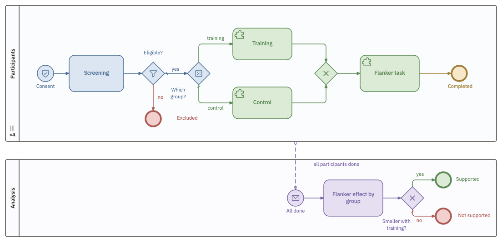
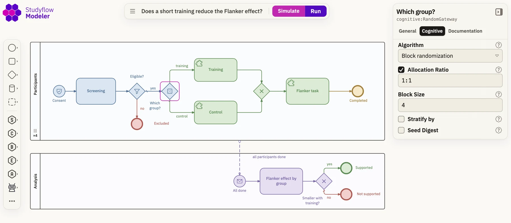
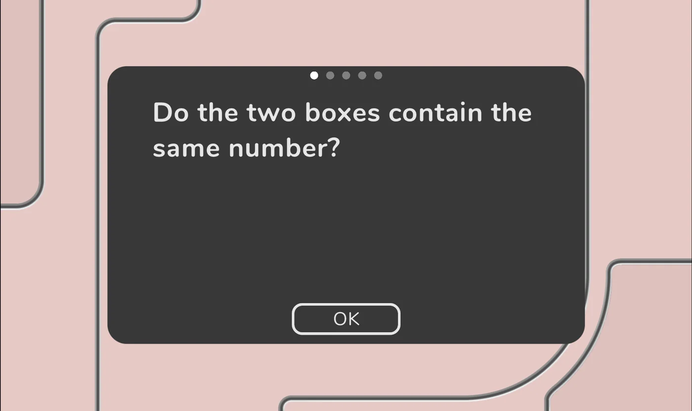
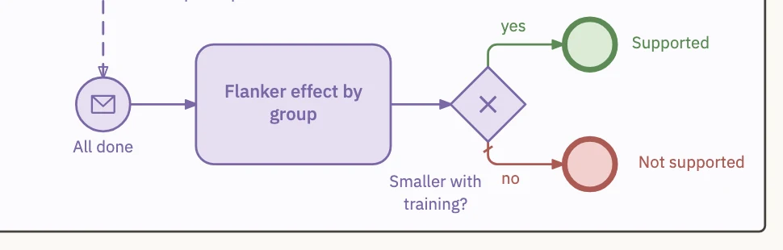
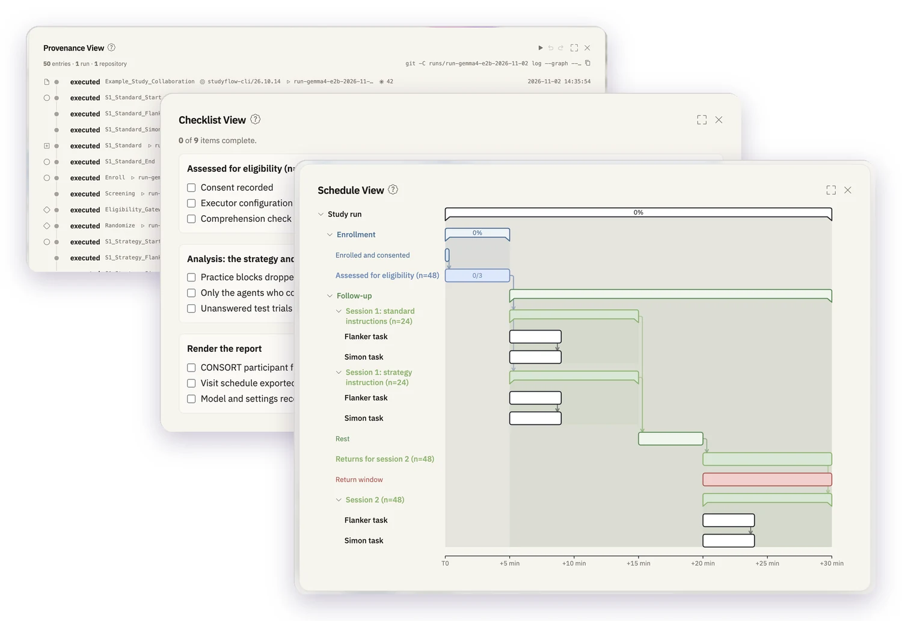

::: {.sf-hero}

#  {#studyflow .unnumbered .unlisted}

[]{.sf-tagline}

[]{.sf-sub}

::: {.sf-actions}
[Open the modeler <i class="bi bi-arrow-right"></i>](https://behaverse.org/studyflow-modeler/app){.sf-btn .sf-btn-primary}
[<i class="bi bi-book"></i> Documentation](https://behaverse.org/studyflow-modeler/docs){.sf-btn .sf-btn-ghost}
[<i class="bi bi-github"></i> GitHub](https://github.com/behaverse/studyflow-modeler){.sf-btn .sf-btn-ghost}
:::
:::

```{=html}
<div class="sf-frame">
  <video autoplay muted loop playsinline poster="../assets/img/studyflow/hero-poster.webp" aria-label="A study simulated in the Studyflow Modeler, with tokens moving from consent through screening and random allocation to the analysis and its claim.">
    <source src="../assets/img/studyflow/hero-simulate.mp4" type="video/mp4">
  </video>
</div>
<p class="sf-caption">A small study, simulated in the Studyflow Modeler.</p>
```

::: {.sf-section}
## A study, described once

[Every audience gets its own copy of a study, and the copies drift apart. Studyflow keeps the whole study in one image that you can view, edit, and run.]{.sf-lead}

```{=html}
<div class="sf-flow">
  <div class="sf-docs">
    <span>Protocol PDF</span><span>Ethics application</span><span>Preregistration</span>
    <span>Experiment script</span><span>Analysis notebook</span><span>Manuscript figure</span>
  </div>
  <i class="bi bi-arrow-right sf-arrow" aria-hidden="true"></i>
  <figure class="sf-png">
    
    <figcaption><i class="bi bi-file-earmark-image"></i> study.png</figcaption>
  </figure>
</div>
```
:::

::: {.sf-section}

::: {.sf-feature}
::: {}
[Design]{.sf-kicker .sf-design}

### Experimental design as a diagram

Consent, screening, allocation, standard data formats, and cognitive tasks are elements of the notation, each holding the parameters the study uses.
:::
{fig-alt="The Studyflow Modeler with a small study on the canvas and the inspector of the random allocation gateway, set to block randomization with a 1:1 ratio and blocks of four."}
:::

::: {.sf-feature .sf-flip}
::: {}
[Run]{.sf-kicker .sf-run}

### Human and artificial participants

The same diagram runs with participants in a web browser, with language models, or with simulated agents.
:::
{fig-alt="A cognitive task from the Behaverse battery running in the Studyflow browser runner."}
:::

::: {.sf-feature}
::: {}
[Analyze]{.sf-kicker .sf-analyze}

### Analysis as part of the protocol

Each research question ends in a claim statement, selected by a decision rule that is registered before data collection.
:::
{fig-alt="An analysis drawn in Studyflow, from a message that all participants are done, through the Flanker effect by group, to a gateway that ends at Supported or Not supported."}
:::

::: {.sf-feature .sf-flip}
::: {}
[Report]{.sf-kicker .sf-report}

### Documents as views of the diagram

Schedules, CONSORT participant flows, checklists, and provenance records are generated from the diagram, so they remain consistent by construction.
:::
{.sf-plain fig-alt="Three views the modeler generates from one study, a provenance log, a checklist, and a schedule with each activity as a bar on one time axis."}
:::

::: {.sf-feature}
::: {}
[Report]{.sf-kicker .sf-report}

### Deviations from the registered protocol

The registered and the executed study are one file at two points in time, so every deviation appears as a line-by-line difference.
:::
```{=html}
<pre class="sf-diff" aria-label="A diff in which the block size of the allocation gateway changed from 4 to 2"> Allocate:
   type: ExclusiveGateway
   name: Which group?
   cognitive:RandomGateway:
     algorithm: block
     allocationRatio: "1:1"
<span class="del">-    blockSize: 4</span><span class="add">+    blockSize: 2</span></pre>
```
:::

:::
